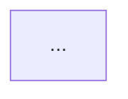

# PR Diff Visualizer

Produce a Mermaid diagram plus a short summary of how `HEAD` differs from its
base branch, and save it to `pr-diff.md` at the repository root.

## Inputs

- **Base branch** (optional): if the user names one ("vs develop", "against
  release/1.2"), pass it to the script. Otherwise pass nothing and let the
  script resolve it.

## Step 1 — Collect the diff

The script ships inside this skill's folder, not in the user's repo. Locate it
relative to **this skill's base directory** (shown as "Base directory for this
skill" when the skill loads; typically `~/.claude/skills/pr-diff-visualizer`
or `<project>/.claude/skills/pr-diff-visualizer`). Never look for
`scripts/collect_diff.sh` in the current working directory.

Run it with the shell's working directory inside the user's repo (any
subdirectory is fine; the script finds the repo root itself):

```bash
bash "<skill-base-dir>/scripts/collect_diff.sh" [base-branch]
```

Invoke it via `bash` as shown so it works even if the executable bit was lost
during install. Quote the path; it may contain spaces.

It prints labelled sections: `BASE`, `HEAD`, `UNCOMMITTED`, `OUTPUT_FILE`,
`COMMITS`, `STAT`, `NAME_STATUS`, `NUMSTAT`, `RESULT`.

- Non-zero exit: report the error message to the user and stop. Don't guess a
  different base unless the user asks, and don't run the fix it suggests
  (e.g. `git fetch --unshallow`) yourself — the skill never fetches.
- `RESULT` is `NO_CHANGES`: tell the user the branch has no committed changes
  vs the base (mention uncommitted changes if listed) and stop; don't write
  `pr-diff.md`.

The script resolves the base in this order: user override → `origin/HEAD` →
`main` → `master`, preferring `origin/<name>` over a local `<name>`. It never
fetches.

## Step 2 — Read the changes that matter

Use `NAME_STATUS` and `NUMSTAT` to pick files, then read their diffs with
`git diff <base_ref>...HEAD -- <path>` (use `base_ref` from the `BASE` section).

- Fields in `NAME_STATUS` and `NUMSTAT` are tab-separated, so paths may
  contain spaces; renames list the old path then the new one.
- Skip noise: lockfiles, generated/minified files, vendored code, snapshots,
  binary files (`-` in `NUMSTAT`). Don't diagram them; count them by type
  and report the counts on the **Not diagrammed** line (Step 6).
- For large PRs, prioritise by lines changed and by structural significance
  (new/deleted files, public interfaces, routes, migrations).

## Step 3 — Identify components and dependencies

Classify each meaningful change into one of:

| Kind | How to spot it |
|------|----------------|
| **Module** | a file or package/directory with changed code |
| **Class** | added/removed/changed class, struct, interface, type |
| **Endpoint** | route decorators/registrations (`@app.get`, `router.post`, `@GetMapping`, `urls.py`, etc.) — label as `METHOD /path` |
| **DB table** | migrations, `CREATE/ALTER/DROP TABLE`, ORM model definitions |

Many repos have none of the last three (scripts, CLIs, libraries, docs,
infrastructure). Then use the kinds that fit instead, still one node per
meaningful change:

| Kind | How to spot it |
|------|----------------|
| **Function** | added/removed/changed function, shell function or command in a script; label as `name()` |
| **Config** | manifests, CI workflows, build/deploy settings, env files |
| **Test** | test files or suites; draw an edge to what they exercise |
| **Doc** | README and other prose; one node per file, no symbol-level nodes |

Several changes inside one file or class (methods, fields) stay one node;
the individual symbols go in the **What changed** table (Step 6). Don't
invent classes, endpoints or tables to fill the diagram.

Status per node:
- **added** — new file or new symbol
- **modified** — existing symbol changed; renames (`R` in `NAME_STATUS`) count
  as modified and are labelled `old → new`
- **deleted** — removed file or symbol

Column and field changes don't get their own nodes. The table or model node
is **modified**, and the columns are listed in the **What changed** table:
`+` added, `−` removed, `~` changed. In a component diagram with room to
spare, up to two may also go in the node label, e.g.
`"users (+ last_order_at)"`.

Dependencies: draw an edge `A --> B` when changed code in A imports, calls,
queries, runs, tests or documents B (e.g. endpoint → service → model → table,
or test → function). Label an edge when the relationship isn't obvious:
`A -->|tests| B`. Only include edges you can see evidence for in the diff or
the touched files; unchanged components that are needed to explain an edge
may appear as plain (unstyled) nodes.

Removed dependencies: when the diff removes an import, call or registration
from a component that still exists, draw the old edge dashed and labelled:
`A -.->|removed| B`. Edges out of a **deleted** node stay solid; the node's
colour already shows they are gone.

## Step 4 — Build the Mermaid flowchart

The diagram is a map, not an inventory. Its job is to show in ten seconds
which parts changed and how they connect. The full list goes in the
**What changed** table (Step 6). Hard limits for every diagram:
**at most 12 nodes and 15 edges.**

### Choose the level of detail

Count the components from Step 3, ignoring noise.

- **12 or fewer → component diagram.** One node per component.
- **More than 12 → overview diagram.** One node per *area*:
  1. Start with one node per top-level app, package or directory that has
     meaningful changes.
  2. If that gives fewer than 6 nodes, split the area with the most changed
     lines into its modules or features, inside one `subgraph`.
  3. Small supporting areas (CI, docs, config) get no node; they go in the
     table.

  Label an area with its name and what changed in counts, e.g.
  `"jobs (new, 6 endpoints)"`. An area is **added** if everything in it is
  new, **deleted** if everything in it is removed, otherwise **modified**.
  Draw one edge per pair of connected areas, not one per component.

### Rules for both

- Use `flowchart TD`, so layers read top to bottom (UI → API → data).
- At most one level of `subgraph`; never a subgraph inside a subgraph.
- Leave out wiring that everything touches: module registration, route
  tables, shared HTTP clients, config, error helpers. They add arrows
  without adding meaning, so they go in the table only, unless the wiring
  is the point of the PR.
- Spend edges carefully: skip an edge that is implied by two others
  (if A → B and B → C, skip A → C) and any edge you would need a label to
  justify but can't.
- DB tables: with four or fewer, put them in a single subgraph titled
  `database` and draw each as a cylinder, `t1[("orders")]`. With more, use
  one cylinder for all of them: `db[("database (9 tables, new)")]`.
- External services (a cloud bucket, a third-party API) appear only when
  the PR adds or changes the integration, as plain unstyled nodes, three
  at most.
- Keep node IDs simple (`n1`, `svc_user`) and quote every label. Keep
  labels under about 40 characters: name first, then the status in
  brackets, `(new)`, `(changed)`, `(removed)` or `(renamed)`, so the
  diagram still reads without colour. Never start a label with `+`, `-`,
  `*` or a number and a dot; Mermaid can read those as a Markdown list.
- No legend nodes. The legend is a line of text under the diagram (Step 6).
- Apply these classes exactly:

```mermaid
classDef added fill:#d4edda,stroke:#28a745,color:#155724
classDef modified fill:#fff3cd,stroke:#d4a017,color:#856404
classDef deleted fill:#f8d7da,stroke:#dc3545,color:#721c24
```

Assign with `class n1,n2 added` etc.

## Step 5 — Write the summary

3–5 plain-English lines: what the PR does, the main areas touched, and
anything a reviewer should watch (schema changes, deleted endpoints,
breaking interface changes, missing tests). No jargon beyond what the code uses.

## Step 6 — Save `pr-diff.md`

Write to `<repo_root>/pr-diff.md` (`repo_root` from the `HEAD` section),
overwriting any existing file. **Never edit `.gitignore` or any other file in
the user's repo.** Use this layout:

````markdown
# PR Diff: <branch> vs <base_ref>

**Base:** `<base_ref>` (<base_source>) · **Merge base:** `<merge_base>` · **Head:** `<head_sha>` · **Commits:** <n>

> ⚠️ Uncommitted changes present — not included in this diagram.   ← only if UNCOMMITTED is dirty

## Diagram



**Legend:** 🟩 new · 🟨 changed · 🟥 removed · dashed arrow = dependency removed

**Not diagrammed:** 1 lockfile, 2 generated files   ← only if files were skipped as noise

## Summary

- ...

## What changed

| Area | Change | Status |
|------|--------|--------|
| API · jobs | 6 endpoints under `/jobs`; `JobsService`, `JobMatcher` | new |
| Database | `users`: + `last_order_at`, − `email` | changed |

<details>
<summary>Raw diff stat</summary>

```
<STAT section>
```

</details>
````

The **What changed** table holds the detail the diagram leaves out: one row
per component from Step 3 (endpoints, classes, tables with their column
changes, wiring files), grouped by area, similar items merged into one row.
Keep it to about 25 rows; beyond that, merge further.

## Step 7 — Report back

In your reply to the user:
- the base used and where it came from (first line)
- the summary
- the path to `pr-diff.md`
- if uncommitted changes exist, say they were not included
- `OUTPUT_FILE` status:
  - `not ignored`: mention they may want to add `pr-diff.md` to `.gitignore`
    — do not do it yourself
  - `tracked`: mention that `pr-diff.md` is committed in this repo and now
    shows as modified; don't suggest `.gitignore` (it has no effect on
    tracked files)
  - `ignored`: say nothing
